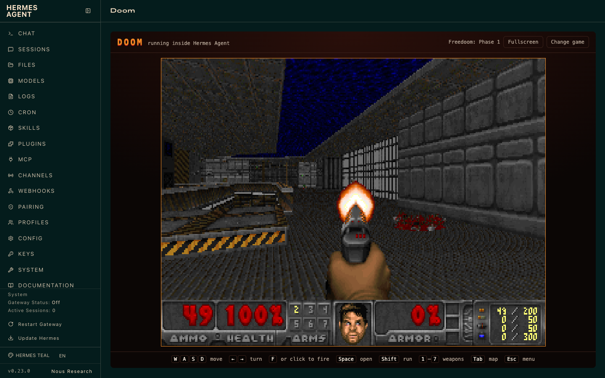

# Doom for Hermes

Play Doom in a tab of the Hermes Agent dashboard while your agents work.



The plugin adds a **Doom** tab. The first time you open it, one click downloads
[Freedoom](https://freedoom.github.io/), the free game data, and the game starts. If you own Doom,
open your own `DOOM.WAD` instead.

## Install

```bash
hermes plugins install SilentKnight87/hermes-doom --enable
hermes dashboard
```

Open the **Doom** tab, choose **Download Freedoom and play**, then click the game to give it the
keyboard.

Requires Hermes 0.23.0 or newer. No Python dependencies and no API keys.

## Controls

| Action | Keys |
| --- | --- |
| Move and strafe | `W` `A` `S` `D`, or the arrow keys |
| Turn | `←` `→` |
| Fire | `F`, `Ctrl`, or click the game |
| Open doors, use switches | `Space` or `E` |
| Run | `Shift` |
| Weapons | `1` to `7` |
| Map | `Tab` |
| Menu | `Esc`, then arrows and `Enter` |

**Change game** in the top bar returns to the game data list.

## Using your own Doom

- **For one session:** choose **Open my own WAD file**. The file is read by this browser tab and is
  never uploaded.
- **To keep it in the list:** copy the IWAD (for example `DOOM.WAD` or `DOOM2.WAD`) into
  `~/.hermes/plugin-data/doom/` and reload the tab.

Only IWAD files are listed. Add-on PWADs are not supported yet.

## What the plugin does on your machine

- **One network download, only when you ask.** Clicking **Download Freedoom and play** fetches
  `freedoom-0.13.0.zip` (24 MB) from the Freedoom project's official GitHub release. The plugin
  checks the archive and the extracted `freedoom1.wad` against SHA-256 digests pinned in
  `dashboard/plugin_api.py` and refuses anything that does not match.
- **Files:** it reads and writes only its own data folder, `~/.hermes/plugin-data/doom/`.
- **Nothing else:** no shell commands, no background processes, no credentials, no telemetry. It
  registers no agent tools, hooks or middleware.
- **No binaries:** the engine is shipped as readable JavaScript, not WebAssembly. See below.

## How it is built

The engine is [doomgeneric](https://github.com/ozkl/doomgeneric), a portable build of id Software's
GPL Doom source. `engine/doomgeneric_hermes.c` is the small platform layer that hands frames to a
canvas and takes key presses. Emscripten 7.0.0 compiles both to plain JavaScript (`-sWASM=0`), which
is `dashboard/dist/doom-engine.js`. Its static data is base64 text inside that file.

To rebuild it yourself with the [Emscripten SDK](https://emscripten.org/docs/getting_started/downloads.html)
on your `PATH`:

1. Check out doomgeneric at commit `e257a09527062bfb986b6e5e0780839b6cbd5b71` into
   `build/doomgeneric`.
2. Run `engine/build.sh`.

Run the backend tests with Hermes's Python:

```bash
python -m unittest discover -s tests
```

## Known limits

- No sound or music yet.
- Saved games last until you reload the tab.
- Keyboard only. There is no mouse look or gamepad support.
- Dashboard only. There is no Hermes Desktop pane yet.

## Licences and credits

- This plugin and the Doom engine source it builds on are licensed under the
  [GNU GPL, version 2 or later](LICENSE). Doom source © id Software; doomgeneric © its contributors.
- Freedoom is © the Freedoom project contributors, under a BSD-style licence. It is downloaded from
  the project, not redistributed here.
- DOOM is a registered trademark of id Software LLC. This is an unofficial community plugin, not
  affiliated with or endorsed by id Software, ZeniMax or Nous Research.
